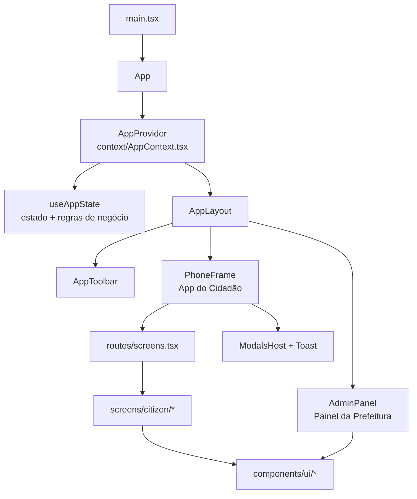

# ARQUITETURA.md

## Estrutura e Funcionamento
A aplicação é uma Single Page Application (SPA) sem roteador de URL, onde a navegação é gerenciada pelo estado `screen` via contexto React e acessada pelo hook `useApp()`.



## Divisão de Camadas
| Camada | Diretório | Responsabilidade | Dependências liberadas |
| --- | --- | --- | --- |
| Domínio | `types.ts`, `data.ts`, `utils.ts` | Tipagem, mocks e utilitários puros (CPF, datas, moeda) | Nenhuma |
| Estado | `context/` | Estado global, regras de negócio e ações do app | Domínio |
| Rotas | `routes/` | Mapeamento de telas, títulos, passos e navegação | Telas |
| Telas | `screens/` | Componentes de página e disparo de ações | Estado, UI e Domínio |
| Layout | `components/layout/` | Shell mobile, menu inferior, toasts e modais | Estado e UI |
| Modais | `components/modals/` | Modais de exceção (4c, 5a, 5b) e declaração do IPTU | Estado e UI |
| Interface | `components/ui/` | Componentes visuais genéricos sem regra de negócio | Tipos do Domínio |

* Componentes em `ui/` não podem importar telas.
* Telas não contêm regras de negócio; a lógica fica concentrada em `context/useAppState.ts`.

## Estrutura de Pastas
```
src/
  App.tsx                      Composição (AppProvider + AppLayout)
  main.tsx                     Ponto de entrada
  types.ts                     Tipagens do sistema
  data.ts                      Mocks de usuários, descartes, ecopontos e constantes
  utils.ts                     Funções utilitárias (CPF, formatação, data)
  index.css                    Tailwind e regras globais de CSS
  context/
    useAppState.ts             Hook centralizador de estado e ações
    AppContext.tsx             Provider do contexto e hook useApp()
  routes/
    screens.tsx                Configuração das telas do cidadão
  components/
    ui/                        Componentes reusáveis da UI
    layout/                    Molduras, menus e feedbacks visuais
    modals/                    Modais do fluxo
  screens/
    citizen/                   Telas da interface do cidadão
    admin/                     Telas da interface administrativa
```

## Estado Global (`useAppState`)
O estado global retorna uma estrutura tipada (`AppState`), dividida nas seguintes categorias:
* Navegação: `screen`, `activeModal`, `toast`.
* Sessão: `users`, `currentUser`, `loginForm`, `registerForm`, `showPassword`.
* Pontuação e Descontos: `pontos`, `discards`, `myDiscards`, `pendingPoints`, `discountValue`, `discountPercent`, `monthlyHistory`.
* Fluxo de Descarte: `photos`, `releaseCode`, `secondsLeft`, `gpsReading`, `simulatedDistance`, `containerCode`, `wasteTypes`, `recyclableSubtypes`, `rating`.
* Suporte e Chamados: `tickets`, `reportForm`.
* Painel Admin: `activeTab`, `searchQuery`, `statusFilter`, `pendingAction`, `rejectionReason`, `lightboxPhoto`, `filteredDiscards`.
* Configurações de Interface: `errors`, `isLoading`, `fontSize`, `highContrast`, `scrollRef`.

Ações exportadas: `navigate`, `notify`, `simulateRequest`, `toggleItem`, `handleLogin`, `handleLogout`, `handleRegister`, `handlePickPhoto`, `handleSubmitPhotos`, `handleGetLocation`, `handleValidateLocation`, `handleCompleteDiscard`, `handleSendAlert`, `approveDiscard`, `rejectDiscard` e `moderateUser`.

## Roteamento
O tipo `Screen` contempla nove estados possíveis:
```ts
type Screen = 'login' | 'register' | 'dashboard' | 'photoUpload' | 'gpsValidation'
            | 'postDescarte' | 'iptuExtrato' | 'reportProblem' | 'adminPanel';
```

* A função `navigate(screen)` limpa erros pendentes e altera a tela visível.
* `routes/screens.tsx` define título, rota de retorno, etapa atual e presença de menu inferior para cada tela.
* O `PhoneFrame` renderiza a moldura mobile, enquanto a tela `adminPanel` é exibida em layout desktop.
* Modais são controlados por `activeModal` (`'4c' | '5a' | '5b' | 'decl'`) e injetados pelo `ModalsHost`.

## Operações Assíncronas Simuladas
* Requisições de formulários (login, cadastro, fotos, alertas): tempo fixo de 800 ms com estado de carregamento.
* Leitura de GPS: delay fixo de 1,4 s com spinner.
* Validade do código de liberação: expira em 10 minutos e retorna o usuário para a Tela 4.
* Toasts de notificação: desfazem-se após 3,8 s.

## Decisões Técnicas
* Uso de React Context + Custom Hook em vez de gerenciadores externos, simplificando a arquitetura para o escopo do projeto.
* Troca de telas via variável de estado `screen`, eliminando rotas de URL e garantindo controle direto.
* Tokens de cor customizados no Tailwind (`pri`, `ok`, `err`, `warn`, `nav`) centralizados no `tailwind.config.js`.
* Path alias `@/` mapeado para `src/`.
* Configuração do TypeScript em modo estrito com `noUnusedLocals` ativo.