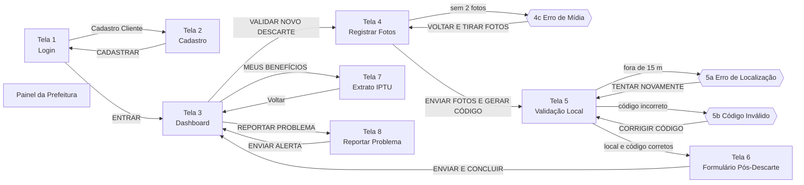

# TELAS-E-FLUXOS.md

## Diagrama de Navegação

## Componentes Globais de Layout
As telas da aplicação mobile são envolvidas pelo `PhoneFrame`, contendo:
1. Cabeçalho institucional com barra de acessibilidade (`GovHeader`)
2. Barra superior com título da tela e botão de retorno
3. Indicador do fluxo de descarte em etapas (`Stepper`)
4. Container interno com rolagem
5. Menu de navegação inferior (`BottomNav`)
6. Camada de overlays para Notificações (`Toast`) e Modais (`ModalsHost`)

## Fluxo das Telas

### Tela 1 - Login (`LoginScreen`)
* Campos de CPF/E-mail e Senha.
* Aplicação automática de máscara de CPF ao digitar números.
* Validação de credenciais e exibição de erro para contas suspensas.

### Tela 2 - Cadastro (`RegisterScreen`)
* Campos de Nome Completo, E-mail, CPF e Senha.
* Indicador de força de senha.
* Bloqueio para CPFs já cadastrados no sistema.

### Tela 3 - Dashboard (`DashboardScreen`)
* Exibição do saldo atual de pontos e desconto em Reais.
* Barra de meta de acúmulo anual.
* Gráfico dinâmico do histórico mensal (`PointsChart`).
* Lista de ecopontos próximos e atalhos de navegação principal.

### Tela 4 - Registro de Fotos (`PhotoUploadScreen`)
* Captura obrigatória de duas imagens: resíduo separado e embalagem lacrada.
* Modal 4c disparado caso o usuário tente prosseguir sem preencher as duas mídias.

### Tela 5 - Validação de Localização e Código (`GpsValidationScreen`)
* Exibição do código temporário de liberação com contagem regressiva de 10 minutos.
* Leitura de GPS com validação de distância máxima de 15 metros (dispara Modal 5a em caso de erro).
* Campo para digitação do código de 4 dígitos do contêiner (exige o código `7589`; dispara Modal 5b em caso de erro).

### Tela 6 - Formulário Pós-Descarte (`PostDischargeScreen`)
* Seleção do tipo de resíduo (Reciclável e/ou Orgânico) e subcategorias.
* Avaliação da conservação e limpeza do ecoponto (1 a 5 estrelas).
* Botão "ENVIAR E CONCLUIR" consolida a pontuação no saldo como pendente e retorna ao Dashboard.

### Tela 7 - Extrato IPTU (`IptuStatementScreen`)
* Informações do imóvel vinculado ao cidadão.
* Detalhamento do valor base do imposto, desconto acumulado e saldo final.
* Histórico com o status de cada descarte efetuado.
* Emissão e visualização de comprovante oficial para impressão em PDF.

### Tela 8 - Reportar Problema (`ReportProblemScreen`)
* Identificação do contêiner e seleção da categoria da ocorrência.
* Campo de observação adicional.
* Acompanhamento dos chamados abertos através da seção "Meus Chamados".

## Tabela de Modais
| Modal | Componente | Gatilho | Ação de Saída |
| --- | --- | --- | --- |
| 4c - Mídia | `MediaErrorModal` | Tentar avançar sem anexar as 2 fotos | Retorna para a seleção de mídias |
| 5a - Localização | `LocationErrorModal` | Distância superior a 15 metros do ecoponto | Permite nova leitura de GPS |
| 5b - Código Inválido | `InvalidCodeModal` | Código do contêiner diferente de `7589` | Permite correção do código informado |
| Declaração IPTU | `DeclarationModal` | Ação "EMITIR DECLARAÇÃO" na Tela 7 | Aciona impressão/exportação em PDF |

## Painel Administrativo (`AdminPanel`)
Interface web em layout expandido:
* Cartões com métricas globais (descartes pendentes, pontos acumulados, chamados abertos e usuários moderados).
* Aba "Auditoria de Descartes": Análise das fotos enviadas, aprovação/homologação dos créditos e rejeição com motivo registrado.
* Aba "Chamados": Alteração do status dos chamados de suporte.
* Aba "Moderação de Usuários": Aplicação de advertências, bloqueio/banimento e reativação de contas.